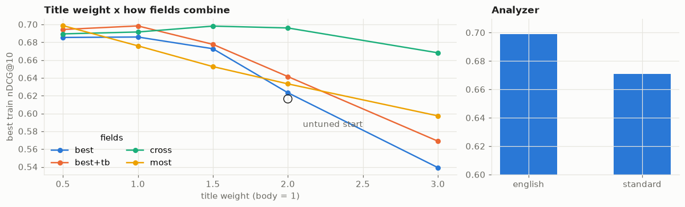
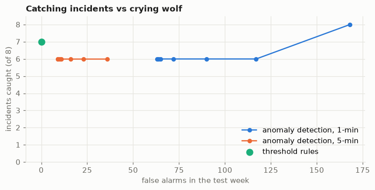

# opensearch-lab

**What is OpenSearch good for, and when is the database you already have good enough?**

OpenSearch is a search engine you run yourself (an open-source fork of Elasticsearch). Instead of
storing rows like a normal database, it builds an *inverted index*, like the index at the back of a
book that lists every page a word appears on. That makes "find the documents that best match these
words, ranked, out of millions" fast.

This project tests it on the three jobs it's most used for, plus the key-value databases it is often
paired with. **Every lesson is scored against a known right answer**, and everything runs locally in
Docker for $0.

| Lesson | Question | Headline |
|---|---|---|
| [1 · Full-text search](notebooks/01_full_text_search.ipynb) | Search engine vs. Postgres? | BM25 0.690 vs Postgres 0.368 nDCG@10; Postgres's usual setting finds nothing for 274/300 questions |
| [2 · Log analytics](notebooks/02_log_analytics.ipynb) | Catch incidents without crying wolf? | Threshold rules catch 7/8 with 0 false alarms; anomaly detection catches the one they miss, at ~10 false alarms/week |
| [3 · Vector & hybrid search](notebooks/03_vector_hybrid_search.ipynb) | Does meaning beat keywords? | Vector +0.057 over tuned BM25; hybrid adds +0.006 (not significant) |
| [4 · Key-value databases](notebooks/04_key_value.ipynb) | When is DynamoDB the right home? | Keyed reads cost 0.5 units; an unplanned question costs 376 (750x) |

## 1 · Full-text search

The test set is **SciFact**: 5,183 scientific paper abstracts and expert-labelled questions (809 for
tuning, 300 kept aside for the final score). Each method returns its top 10 abstracts.

| Method | nDCG@10 | Recall@10 | Time per search |
|---|---|---|---|
| OpenSearch BM25, tuned on the 809 tuning questions | **0.690** | **0.820** | 1 ms |
| OpenSearch BM25, untuned | 0.610 | 0.750 | 1 ms |
| Postgres full-text, any word may match | 0.368 | 0.514 | 40-80 ms |
| Postgres full-text, every word must match | 0.072 | 0.073 | <1 ms |

- **Recall@10**: the share of the right answers that showed up in the top 10. **nDCG@10** also
  rewards putting them near the *top*; 1.0 is perfect.
- "Every word must match" is Postgres's usual search-box setting. On real questions it found
  **nothing at all** for 274 of 300, because no abstract contains every word of a long question.


- **Tuning** tried 640 settings on the tuning questions only, then scored the test questions once:
  +0.079 (95% interval +0.055 to +0.105). The biggest lever was how much the title counts; the BM25
  parameters textbooks focus on (`k1`, `b`) barely mattered.
- **Typos:** one typo per question costs 0.04; fuzzy matching wins most of it back (0.681) and costs
  nothing on clean questions. A small synonym list made no measurable difference.

## 2 · Log analytics

Two simulated weeks of web-shop logs (1.2 million lines), shipped by **Fluent Bit** into daily indices
with a 30-day retention policy. Week 1 is clean and only sets thresholds. Week 2 has **8 incidents
injected at known times** (error spike, slow search, credential stuffing, outage; a big and a subtle
version of each).

| Detector | Caught (of 8) | False alarms in the test week | Median minutes to detect |
|---|---|---|---|
| Threshold rules (set from the clean week) | 7 | **0** | 2 |
| Anomaly Detection plugin, 1-minute, grade ≥ 0.8 | 6 | 65 | 0 |
| Anomaly Detection plugin, 5-minute, grade ≥ 0.8 | 6 | 10 | 2 |
| Rules + 5-minute anomaly detection | **8** | 9 | 1 |



- A fixed "too little traffic" line misses the subtle outage; a rule that compares with the **normal
  traffic for that time of day** catches it.
- Every shop-wide rule misses the subtle checkout error spike (checkout is 8% of traffic). Anomaly
  detection, modelling each endpoint separately, catches it.
- Anomaly detection at 1-minute resolution is too noisy to page anyone with: per-endpoint counts per
  minute are tiny at night. It's also random: re-runs give somewhat different results.

## 3 · Vector and hybrid search

Same questions and labels as lesson 1, using bge-large embeddings (1,024 numbers per text) reused
from the rag-bedrock-compare project.

| Method | nDCG@10 | Recall@10 |
|---|---|---|
| Hybrid (BM25 + vector, min-max blend, 80% vector, weight picked on tuning questions) | **0.752** | 0.877 |
| Hybrid, reciprocal rank fusion | 0.750 | 0.872 |
| Vector: OpenSearch k-NN = pgvector = exact brute force | 0.746 | 0.873 |
| BM25 tuned (lesson 1) | 0.690 | 0.820 |

Vector search beats tuned BM25 by +0.057 (95% interval +0.023 to +0.090). Hybrid's extra +0.006 is
**not** distinguishable from noise (interval -0.006 to +0.018). Both approximate (HNSW) indexes found
exactly the brute-force top 10.

## 4 · Key-value databases

DynamoDB Local (AWS's emulator) with the same abstracts and a synthetic reading history (50,000
views). DynamoDB bills reads in *read capacity units*, and the emulator reports them as AWS would.

| Question | Read units | $ per million requests* |
|---|---|---|
| Get one abstract by id | 0.5 | 0.06 |
| A user's last 20 reads (partition + sort key) | 0.5 | 0.06 |
| Who read abstract X? (no key → full scan) | 376 | 47 |
| Who read abstract X? (after adding a secondary index) | 13 | 1.6 |

\*On-demand list price $0.125 per million read units, us-east-1, not re-verified.

A **DynamoDB Streams** change feed kept an OpenSearch index in sync: exact copy (5,183 items,
identical text) after load, an edit and a delete.

## How it fits together

Postgres holds the documents (the source of truth); OpenSearch indices are rebuilt from it. In lesson 4
DynamoDB plays the same role, feeding OpenSearch through its change feed. A search index is a fast,
rebuildable copy, not where the real data lives.

## Run it

```bash
docker compose up -d                       # OpenSearch :9200, Dashboards :5601, Postgres :5432, DynamoDB :8000
python3 -m venv .venv && source .venv/bin/activate
pip install -r requirements.txt -r requirements-dev.txt && pip install -e .

# lesson 1
python -m oslab fetch && python -m oslab load && python -m oslab sync
python -m oslab tune                       # ~3 min: 640 settings on the tuning questions
# lesson 3 (needs the vectors: scripts/export_bge.py, run with rag-bedrock-compare's venv)
python -m oslab hybrid
python -m oslab eval && python -m oslab report

# lesson 2
python -m oslab logs                       # 1.2 M log lines + index template + retention policy
docker compose --profile logs up -d fluent-bit
python -m oslab detect                     # waits for ingestion, scores rules + anomaly detection (~5 min)

# lesson 4
python -m oslab kv

python notebooks/build.py                  # then execute each notebook (see notebooks/build.py)
pytest -q                                  # stack tests skip if Docker is down
docker compose --profile logs down         # add -v to also delete the data
```

Needs Docker and about 5 GB of free RAM. On Linux, OpenSearch also needs
`sudo sysctl -w vm.max_map_count=262144` if your system's value is lower.
